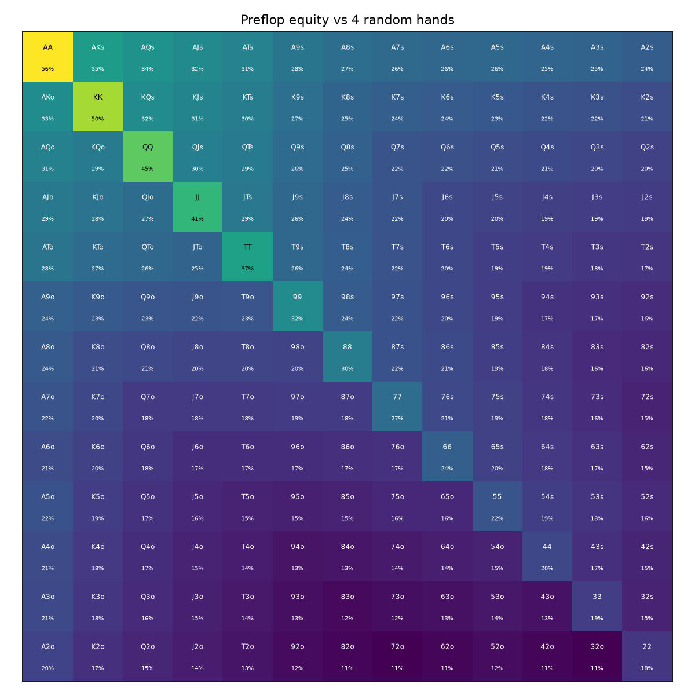

# poker-bot

A poker AI playground in Python: a fast hand evaluator, a Monte Carlo equity calculator, a 5-player bot simulator, and a counterfactual regret minimization (CFR) solver for push-or-fold poker, plus the charts that come out of them. The hot loops are compiled with [Numba](https://numba.pydata.org/), so 200,000 equity runouts take a quarter of a second, the simulator plays about 13,000 hands a second per core, and the solver runs 600,000 CFR iterations a second.

```bash
pip install -e ".[dev]"
pytest -q
```

## 1. Monte Carlo equity calculator

Deal random runouts thousands of times and count how often each hand wins. Known hands, a partial board, and any number of random opponents can be mixed.

```
$ pokerbot equity AsAh -o 4
AsAh + 4 random, board [-], 200,000 runouts in 0.26s
hand  equity     win    tie
AsAh  55.76%  55.54%  0.56%

$ pokerbot equity AhKh QsQc --board Qh7h2c
hand  equity     win    tie
AhKh  25.40%  25.40%  0.00%
QsQc  74.60%  74.60%  0.00%
```

`pokerbot table -o 4` prints the 169-hand preflop table, which ships precomputed in [pokerbot/data/preflop_equity.json](pokerbot/data/preflop_equity.json) (100,000 runouts per hand against 1 to 4 random opponents).



From Python:

```python
from pokerbot import equity
equity(["AsAh", "KdKc"], board="2c7d9h", opponents=2, iterations=100_000)
```

## 2. Five-player bot simulator

[pokerbot/engine.py](pokerbot/engine.py) deals fixed-limit hold'em (blinds 0.5/1, bets 1/1/2/2, 4-bet cap) between bots defined in [pokerbot/bots.py](pokerbot/bots.py). Each bot sees its cards, the board, the pot, and the price to call, and can ask for its equity against the opponents still in the hand. Seats are reshuffled every 5,000 hands and the button rotates every hand, so position luck washes out.

| bot | style |
| --- | --- |
| `tag` | tight-aggressive: raises good hands, calls when equity beats the pot odds |
| `rock` | tight-passive: premium hands only, mostly calls |
| `maniac` | loose-aggressive: plays most hands, raises often, bluffs 30% of the time |
| `station` | calls everything |
| `random` | uniform among legal actions |
| `math` | pure pot-odds caller that raises with a clear edge |

```
$ pokerbot simulate -n 1000000 -w 4
    bot    hands  bb/100  ±95%  VPIP%  PFR%  WSD%
 maniac  1000000  155.03  2.12   83.6  59.0  48.5
    tag  1000000    81.2  1.55   15.8   9.9  53.3
   rock  1000000   16.78   0.9    5.5   1.1  57.6
station  1000000  -88.31  1.98   95.3   0.0  40.8
 random  1000000  -164.7  1.24   65.6  38.2  42.4
```


Against a table with a calling station and a random bot, relentless aggression pays best: the maniac's raises get called by worse hands and its bluffs are only called by the station. Swap the lineup (`--bots tag rock maniac math math`) and the ordering changes, which is the fun part. To add a bot, subclass `Bot`, implement `act(obs)` returning `"f"`, `"c"`, or `"r"`, and register it in `BOTS`.

## 3. Push/fold equilibrium with CFR

[pokerbot/pushfold.py](pokerbot/pushfold.py) solves the short-stack game where every player either shoves all-in or folds, and anyone facing a shove calls or folds. Information sets are (seat, which earlier seats are already in, hand class), so a 5-max game has 31 decision nodes times 169 hands.

The solver is chance-sampled CFR+: each iteration deals five hands and a board, which fixes the payoff of all 32 in/out combinations, then walks the tree bottom-up and updates every player's regrets at once. Regrets are floored at zero and the average strategy is weighted linearly by iteration. Heads-up at 10bb it lands on the known Nash ranges (SB shoves 57%, BB calls 39%), and two seeds at 60M iterations agree to within 0.2 points.

```
$ pokerbot solve -p 5 -s 10
5-max push/fold at 10bb, ante 0: 20,000,000 CFR+ iterations in 34s
UTG open-shoves 20.5% ...
```


The grids show how often each hand goes in. Hands that sit near 0% or 100% are clear decisions; the mixed ones in between are close to break-even, and the few-percent floor on trash hands is left over from the early, near-random iterations in the average.

## 4. Analysis: how ranges move with stack size

`pokerbot charts` reruns the solver at every stack depth from 3bb to 25bb and redraws every chart in [docs/img](docs/img).


| stack | UTG | CO | BTN | SB | BB calls SB |
| ---: | ---: | ---: | ---: | ---: | ---: |
| 3bb | 33.2% | 37.4% | 43.3% | 75.6% | 85.1% |
| 5bb | 30.4% | 33.8% | 40.3% | 68.3% | 58.7% |
| 10bb | 21.3% | 26.5% | 32.5% | 54.5% | 36.9% |
| 15bb | 16.0% | 20.7% | 28.0% | 43.6% | 28.8% |
| 25bb | 11.2% | 14.2% | 19.7% | 34.7% | 20.1% |

## Caveats

- Bots estimate equity against random hands, not against what their opponents' actions say they hold. That is the obvious next upgrade.
- CFR is only guaranteed to find a Nash equilibrium in two-player zero-sum games. In 5-player push/fold it converges to a stable, sensible strategy, but that is an empirical result, not a theorem.
- Payoffs are chip EV. Tournament pay jumps (ICM) are not modeled, and the solver allows no limping or min-raising.

## Layout

```
pokerbot/
  cards.py        card parsing ("As" -> 48)
  evaluator.py    7-card hand evaluator (Numba)
  equity.py       Monte Carlo equity
  preflop.py      169 hand classes and the precomputed preflop table
  engine.py       fixed-limit hold'em dealer
  bots.py         rule-based bots
  simulate.py     multi-process tournament runner and stats
  pushfold.py     CFR+ push/fold solver
  charts.py       matplotlib charts
  cli.py          the `pokerbot` command
tests/            evaluator vs brute force, equity sanity, engine zero-sum, solver ranges
```
